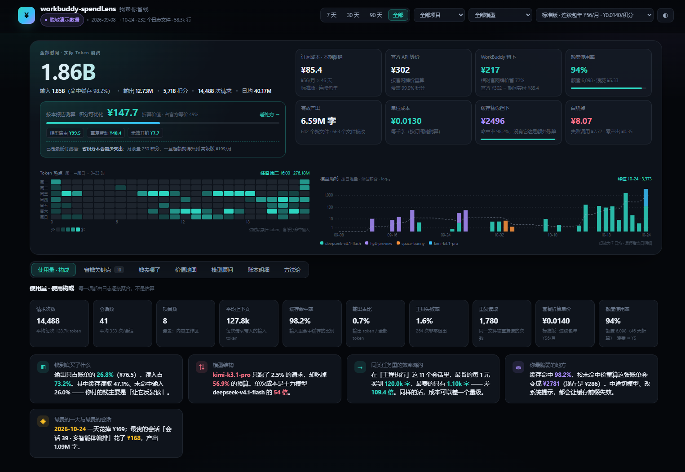
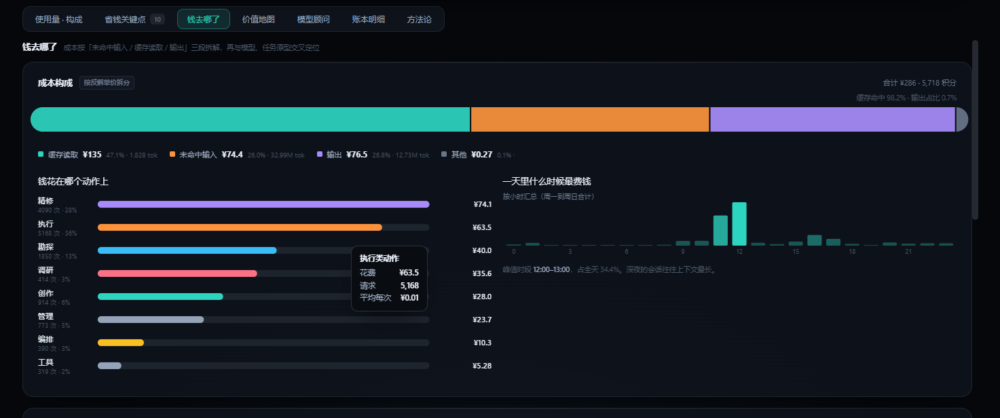
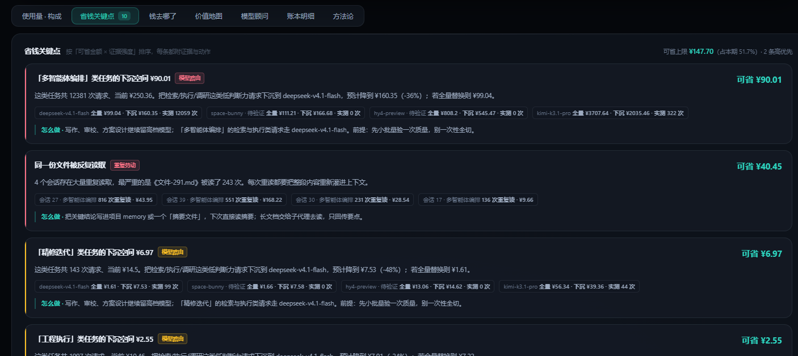
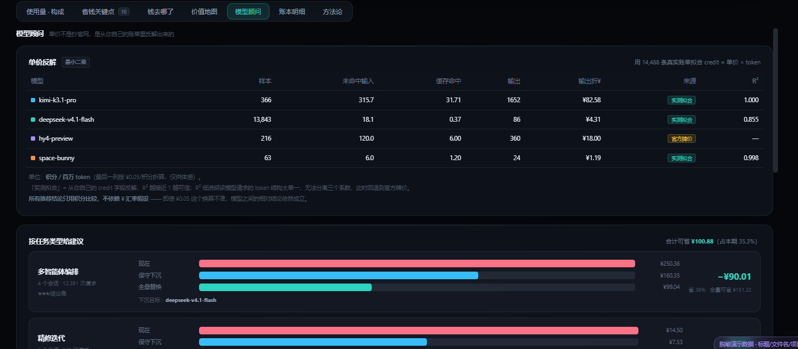
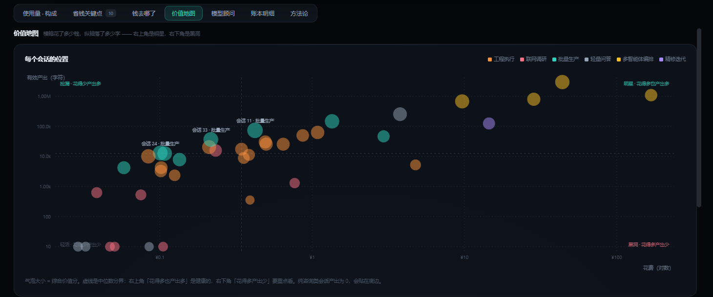
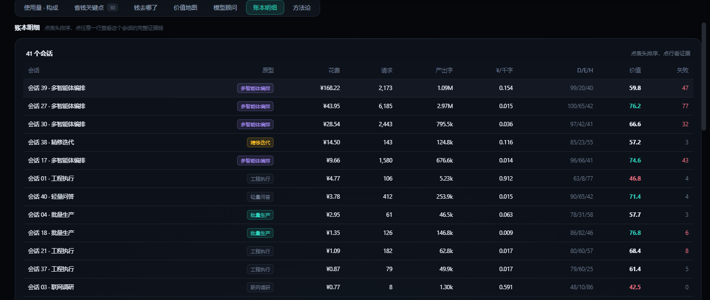

# workbuddy-spendLens · 我帮你省钱

一个离线、单文件的 WorkBuddy 用量分析网页：在本机浏览器中解析请求级日志，把 Token、积分、套餐成本、模型消耗与任务产出放在一起，给出可以回到明细复核的优化建议。

> WorkBuddy「1024 造物挑战」参赛作品。非官方工具，不上传日志，不依赖后端服务。

## 在线查看

仓库内已包含可直接打开的单文件版本：

- `out/workbuddy-spendLens.html`：正式版，由你在本机选择或拖入 WorkBuddy 日志目录。
- `out/workbuddy-spendLens-脱敏演示版.html`：内嵌脱敏演示数据，双击即可查看，无需读取任何本机日志。

也可以直接使用仓库的 **Releases / Pages**（如已启用）。单文件 HTML 不依赖 CDN、框架或外部字体。

## 界面预览

以下截图来自脱敏演示版；会话标题和文件名字段已中性化，数值用于展示真实的数据结构。













## 它能回答什么

- **实际用了多少**：Token、请求、积分、缓存命中、有效产出与失败调用。
- **钱怎么算**：支持积分牌价与真实套餐口径，订阅费按日历天摊销，而不是按有活动的天数计算。
- **官方 API 等价是多少**：用真实 Token 结构套公开牌价；无公开牌价的模型不强行估算，并显示覆盖范围。
- **消耗发生在哪里**：按项目、会话、任务原型、模型、工具和成本结构交叉拆解。
- **什么时候消耗异常**：首屏提供星期 × 小时 Token 热点图，以及按日、按模型的积分堆叠图与 7 日均线。
- **下次改什么**：省钱处方、模型保守下沉模拟、价值地图和可下钻的账本明细。

## 一页式功能导览

| 页签 | 用途 |
|---|---|
| 使用量 · 构成 | 查看请求、Token、积分、缓存与产出 |
| 省钱关键点 | 查看带证据、动作和估算上限的优化建议 |
| 钱去哪了 | 定位成本结构、模型、任务原型与项目消耗 |
| 价值地图 | 对照成本与可复用产出，寻找高效率和低效率会话 |
| 模型顾问 | 查看单价来源、候选模型与反事实模拟 |
| 账本明细 | 排序、筛选并下钻到单个会话的证据链 |
| 方法论 | 查看公式、拟合质量、计费口径与已知误差 |

## 快速开始

### 方式 A：直接看脱敏演示

下载或双击：

```text
out/workbuddy-spendLens-脱敏演示版.html
```

演示数据中的会话标题统一为 `会话 NN · 任务原型`，文件名统一为 `文件-NN.ext`，项目名按序号中性化。公开仓库不包含原始日志、真实会话标题、真实文件名或本机用户路径。

### 方式 B：分析自己的日志

打开：

```text
out/workbuddy-spendLens.html
```

三选一接入：

1. 在支持的浏览器中直连 `~/.workbuddy/projects`。
2. 拖入或选择包含 `.jsonl` 日志的文件夹。
3. 恢复保存在本机浏览器 IndexedDB 中的上次快照。

浏览器不允许网页在未授权的情况下读取本地磁盘，因此首次必须手动选择目录或拖入文件夹。正式版不会自动上传任何数据。

Windows 也可以运行 `启动预览.bat`，通过 `http://127.0.0.1:8765/` 使用目录直连。

## 计费口径

### 订阅成本

套餐模式下，期间费用按日历跨度摊销：

```text
期间费用 = 所选周期月费 × 日历天数 / 30.4375
```

日摊成本与 7 / 30 / 90 天窗口无关；没有调用的一天也属于订阅期。

### 官方 API 等价

```text
Σ((未命中输入 / 1e6) × 未命中单价
  + (缓存命中 / 1e6) × 缓存单价
  + (输出 / 1e6) × 输出单价)
```

### WorkBuddy 省下

```text
官方 API 等价 − 当前成本口径
```

“官方 API 等价”是参照值，不是另一张真实账单；“优化空间”是规则引擎的粗估上限，也不是节省承诺。订阅制下，**省积分不一定等于省现金**：通常只有能够降档，或避免超额升档，才会形成现金变化。

## 单价与模型建议

可从请求记录中拟合每个模型的三项单价：

```text
credit ≈ pm × (未命中输入 / 1e6)
       + ph × (缓存命中 / 1e6)
       + po × (输出 / 1e6)
```

页面展示拟合来源与 R²；拟合不稳定时回退公开牌价。模型比较使用积分，不依赖固定的人民币兑换率。

模型替换模拟属于同结构外推，假设 Token 结构、缓存行为和输出长度相近，不代表替换后质量不变。候选模型需要足够的同类任务样本，优势不足时会建议保持现状。

## 隐私设计

- 解析、聚合、评分和图表均在浏览器本机完成。
- 页面无后端、无上传接口、无外链资源，断网可用。
- 快照仅保存在本机 IndexedDB。
- `tools/raw.json`、私人敏感词表和所有 `.jsonl` 日志均被 `.gitignore` 排除。
- 公开构建脚本不包含本机用户名、私人工作区映射或真实敏感词表。
- 脱敏构建校验会话标题、所有文件字段及常见个人磁盘路径。

如需重建自己的脱敏演示，可在 `tools/sensitive.txt` 中每行放置一个私人敏感串。该文件不会提交；词表本身也可能包含隐私，因此仓库只提供机制，不提供真实词表。

## 从源码构建

要求：Python 3、Node.js（仅重建演示数据时需要）。

```bash
# 只构建正式版，不读取日志
python build.py --no-demo

# 构建正式版，并从本机 WorkBuddy 日志重建脱敏演示
python build.py

# 本地引擎与边界检查（会读取你自己的本机日志）
node test/run.js
node test/edge.js
```

构建产物写入 `out/`。没有日志或不想读取日志时，直接使用仓库中已有的两个 HTML 即可。

## 目录

```text
src/                 页面、样式、聚合、图表与交互
out/                 可直接打开的单文件正式版与脱敏演示版
test/                本机对账和边界测试
tools/dump.js        将本机日志转为本地临时快照（输出不入库）
build.py             单文件打包、结构脱敏与隐私校验
启动预览.bat          Windows 本地预览
```

## 已知边界

- 跨会话比较存在任务难度等混杂因素，模型建议不是因果结论。
- credit 取整会影响小额请求的单价拟合精度。
- 会话级产出在按时间或模型筛选时存在近似折算。
- 价值评分衡量可复用资产，不代表一次纯问答是否有用。
- 套餐额度、加赠活动和公开牌价可能变化，应以实际订阅与官方页面为准。
